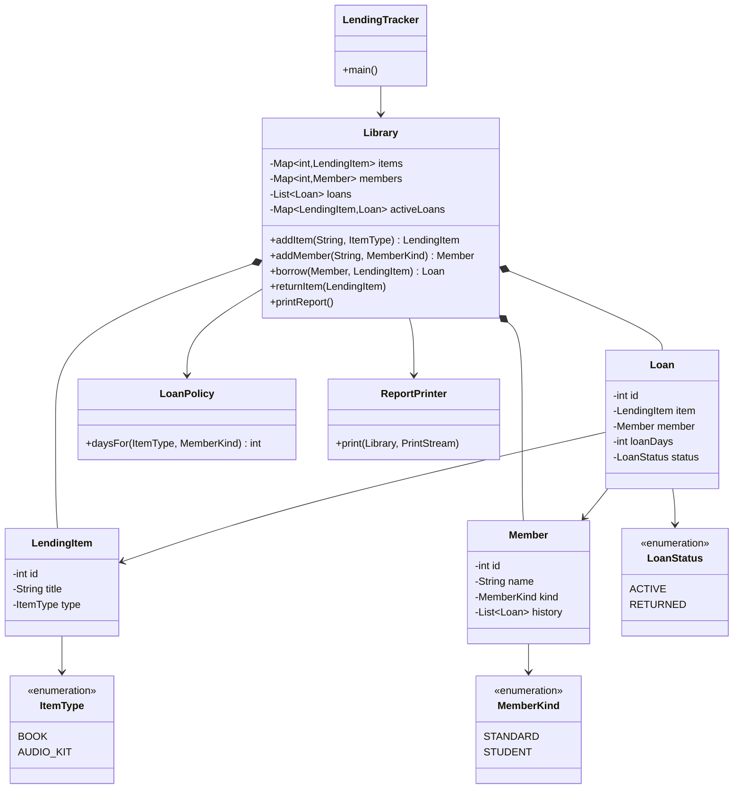

# Diagnosis — The Reading Room

## Summary

The tracker works on the happy path, but its model does not enforce the one rule the
library depends on: a physical item is either available or on exactly one loan. State is
duplicated, publicly mutable, and keyed by display strings, so invalid records are easy to
create and hard to notice. The rebuild keeps today's loan rules, messages, and report
format, and makes that invariant structural.

## Critical defects

### 1. An item can be on two loans at once

**What happens:** `Library.borrow` never checks whether the item is already out. It
overwrites `status` and `currentBorrower`, then appends a second active loan. The supplied
demo does exactly this with *Things Fall Apart* (lines 24–29), producing loans #1 and #3
for the same book.

**Root cause:** Availability is a mutable label stored on `LendingItem`, not an invariant
owned by `Library`. `borrow` has no precondition, and the model permits contradictory
state.

**Why it matters:** Two members can believe they hold the same book while the report names
only the second. Staff cannot tell who actually has it. This is a silent inventory error,
not a visible failure.

### 2. Returns are keyed by title, not item identity

**What happens:** `returnItem` closes every active loan whose `itemTitle` matches, and it
accepts any item — even one that was never borrowed. `Loan` stores copied `itemTitle` and
`memberName` strings instead of references to the actual objects.

**Root cause:** Display text is being used as the identity of an item and a member. Titles
are not unique in a library, and names are not unique either.

**Why it matters:** Two copies of the same title are indistinguishable. Returning one copy
can close another member's loan while the item is still physically out. Renaming an item
after lending breaks the link permanently, leaving a loan active forever.

### 3. The model has two competing sources of truth

**What happens:** An item's custody lives in both `LendingItem.status`/`currentBorrower`
and `Loan.status`. `returnItem` updates both without checking them against each other, and
callers can change one without the other.

**Root cause:** There is no aggregate boundary or single owner of the loan lifecycle, so
the same fact is stored twice.

**Why it matters:** The report can show an item `ON_LOAN` with zero active loans, or an
active loan for an item marked `AVAILABLE`. The end-of-day report is the business's
reconciliation tool; once it can contradict itself, staff cannot trust it.

### 4. State is publicly mutable and internal collections escape

**What happens:** Every entity field is `public`. `Library.items` and `Library.members` are
public lists, `getLoans()` returns the live internal list, and ID counters are public
statics. A caller can clear all loans while items remain marked on loan, or change an ID
sequence with one assignment.

**Root cause:** No encapsulation. The domain has no boundary between "what a volunteer may
change" and "what keeps the records valid".

**Why it matters:** A well-meaning extension can corrupt the records by accident, and
tests interfere with each other through shared static state. This is the structural reason
the code is unsafe to change.

### 5. Invalid data is accepted, and failures are not atomic

**What happens:** `type`, `kind`, and `status` are raw strings. An unknown item type creates
a 0-day *active* loan while leaving the item `AVAILABLE`. A null title is accepted, then
poisons every later return with a `NullPointerException`. If `member.history` is null,
`borrow` marks the item on loan and then throws, leaving it on loan with no loan record.

**Root cause:** No closed value sets or validation, and state is mutated before all failure
points have been passed.

**Why it matters:** One bad record can block unrelated operations and silently corrupt the
inventory. Volunteers get raw exceptions instead of clear refusals, and the damage is
already written by the time the error appears.

## Most dangerous for this business

**Defect 1 — double lending — is the most dangerous.**

The Reading Room's only product is trustworthy custody tracking. A crash is visible and
recoverable; a double loan is silent and directly produces a false report. It occurs in
normal use (any second request for a popular title), and the report is exactly what staff
use to reconcile the shelf. The result is a lost book, two members with a legitimate claim
to it, and no record that can settle the dispute.

Defect 4 is what makes this easy to do, but defect 1 is the direct business harm. That is
why the rebuild makes exclusivity structural rather than a check that a future volunteer
must remember to add.

## Planned structure



- **`Library` is the only mutator.** Its private `activeLoans` map is the single source of
  truth for custody: `borrow` checks it, and `returnItem` removes exactly the entry for
  that item. `LendingItem` has no status or borrower fields to contradict.
- **`Loan` references the real `LendingItem` and `Member` objects.** Duplicate titles are
  fine because returns use object identity, and renaming cannot break a loan.
- **Closed value sets.** Enums replace strings, and `LoanPolicy` holds the four loan
  periods in one place. Adding a new item type or member kind touches one enum, one policy
  rule, and its tests.
- **No leaked state.** Collections are private, getters return read-only copies, IDs are
  owned by the library, and the public static counters disappear.
- **Validate before mutate.** Invalid operations throw a domain exception and leave state
  unchanged. The demo catches the expected refusal and prints it; every valid path prints
  exactly as it does today.
- **Testable output.** `ReportPrinter` writes to an injected `PrintStream`, and a
  golden-output test pins the current report format. Tests cover all four loan periods,
  duplicate-title copies, returns by identity, and rejection of a second loan.

Proposed package layout:

```text
src/
├── main/
│   └── java/
│       ├── LendingTracker.java
│       └── com/
│           └── amalitech/
│               └── training/
│                   └── readingroom/
│                       ├── Library.java
│                       ├── LendingItem.java
│                       ├── Member.java
│                       ├── Loan.java
│                       ├── ItemType.java
│                       ├── MemberKind.java
│                       ├── LoanStatus.java
│                       ├── LoanPolicy.java
│                       └── ReportPrinter.java
│
└── test/
    └── java/
        └── com/
            └── amalitech/
                └── training/
                    └── readingroom/
                        ├── (domain tests)
                        └── (report tests)
```

## Behaviour that must not change

- BOOK loans: 14 days standard, 28 days student.
- AUDIO_KIT loans: 7 days standard, 14 days student.
- Successful messages, report layout, item/loan ordering, and loan numbering.
- The only intended change: the demo's second borrow of *Things Fall Apart* is refused,
  so the report shows the novel with Kofi rather than Ama.

No new features (due dates, fines, persistence, concurrency) are part of this rebuild.
