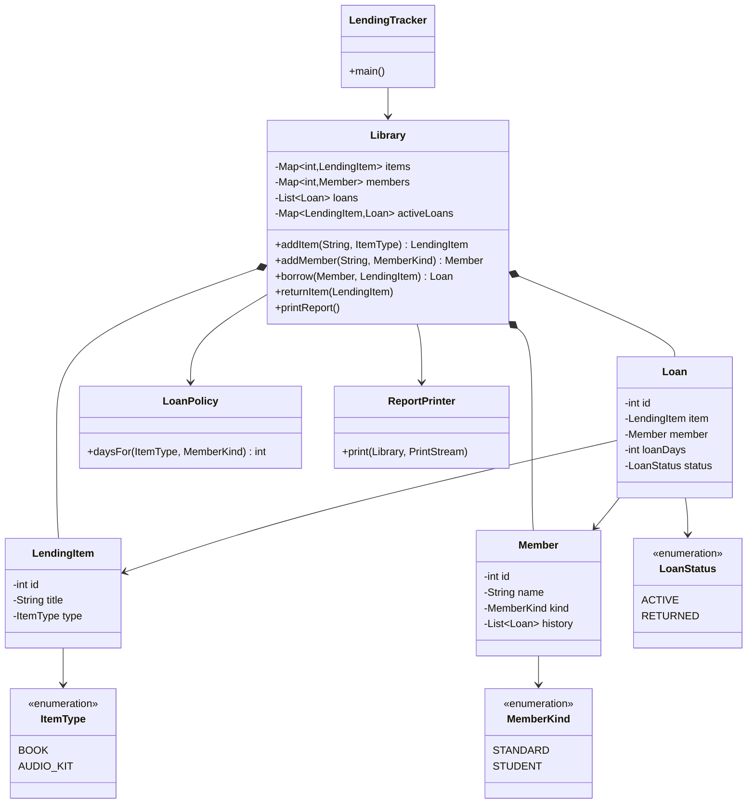

# Diagnosis — The Reading Room

## Summary

The tracker works on the happy path, but its model does not enforce the one rule the
library depends on: a physical item is either available or on exactly one loan. State is
duplicated, publicly mutable, and keyed by display strings, so invalid records are easy to
create and hard to notice. The rebuild keeps today's loan rules, messages, and report
format, and makes that invariant structural.

## Critical defects

### 1. An item can be on two loans at once

`Library.borrow` never checks whether the item is already out. It overwrites the borrower
and adds a second active loan; the demo does this to *Things Fall Apart* (loans #1 and #3).

**Root cause:** availability is a label on the item, not a rule enforced by `Library`.

**Why it matters:** two members can believe they hold the same book while the report names
only one, so staff cannot tell who actually has it.

### 2. Returns are keyed by title, not item identity

`returnItem` closes every active loan with the same title and accepts any item, even one
that was never borrowed. `Loan` stores copied titles and names instead of the actual objects.

**Root cause:** display text is used as identity, but titles and names are not unique.

**Why it matters:** returning one copy can close another member's loan, and renaming an item
breaks the link permanently.

### 3. The model has two competing sources of truth

Custody is stored on both the item (`status`, `currentBorrower`) and the loan (`status`), and
the two can be changed separately.

**Root cause:** no single owner of the loan lifecycle.

**Why it matters:** the report can show an item on loan with no active loan, or available
with an active loan. Staff cannot trust the end-of-day report.

### 4. State is publicly mutable

All entity fields are public, `items` and `members` are public lists, `getLoans()` returns the
live internal list, and ID counters are public statics.

**Root cause:** no encapsulation between callers and the records.

**Why it matters:** any caller can corrupt records by accident, and tests interfere with each
other through shared static state.

### 5. Invalid data is accepted, and failures are not atomic

Types, kinds, and statuses are raw strings. An unknown item type creates a 0-day active loan;
a null title later crashes returns; a null history leaves an item on loan with no loan record.

**Root cause:** no validation or closed value sets, and state changes before all checks pass.

**Why it matters:** one bad record can block unrelated operations and silently corrupt the
inventory, with the error appearing only after the damage is written.

## Most dangerous for this business

**Defect 1 — double lending — is the most dangerous.**

The Reading Room's only product is trustworthy custody tracking. A crash is visible and
recoverable; a double loan is silent and directly produces a false report. It occurs in
normal use (any second request for a popular title), and the report is exactly what staff
use to reconcile the shelf. The result is a lost book, two members with a legitimate claim
to it, and no record that can settle the dispute.

Defect 4 is what makes this easy to do, but defect 1 is the direct business harm. That is
why the rebuild makes exclusivity structural rather than a check that a future volunteer
must remember to add.

## Planned structure



- **`Library` is the only mutator.** Its private `activeLoans` map is the single source of
  truth for custody: `borrow` checks it, and `returnItem` removes exactly the entry for
  that item. `LendingItem` has no status or borrower fields to contradict.
- **`Loan` references the real `LendingItem` and `Member` objects.** Duplicate titles are
  fine because returns use object identity, and renaming cannot break a loan.
- **Closed value sets.** Enums replace strings, and `LoanPolicy` holds the four loan
  periods in one place. Adding a new item type or member kind touches one enum, one policy
  rule, and its tests.
- **No leaked state.** Collections are private, getters return read-only copies, IDs are
  owned by the library, and the public static counters disappear.
- **Validate before mutate.** Invalid operations throw a domain exception and leave state
  unchanged. The demo catches the expected refusal and prints it; every valid path prints
  exactly as it does today.
- **Testable output.** `ReportPrinter` writes to an injected `PrintStream`, and a
  golden-output test pins the current report format. Tests cover all four loan periods,
  duplicate-title copies, returns by identity, and rejection of a second loan.

Proposed package layout:

```text
src/
├── main/
│   └── java/
│       ├── LendingTracker.java
│       └── com/
│           └── amalitech/
│               └── training/
│                   └── readingroom/
│                       ├── Library.java
│                       ├── LendingItem.java
│                       ├── Member.java
│                       ├── Loan.java
│                       ├── ItemType.java
│                       ├── MemberKind.java
│                       ├── LoanStatus.java
│                       ├── LoanPolicy.java
│                       └── ReportPrinter.java
│
└── test/
    └── java/
        └── com/
            └── amalitech/
                └── training/
                    └── readingroom/
                        ├── (domain tests)
                        └── (report tests)
```

## Behaviour that must not change

- BOOK loans: 14 days standard, 28 days student.
- AUDIO_KIT loans: 7 days standard, 14 days student.
- Successful messages, report layout, item/loan ordering, and loan numbering.
- The only intended change: the demo's second borrow of *Things Fall Apart* is refused,
  so the report shows the novel with Kofi rather than Ama.
